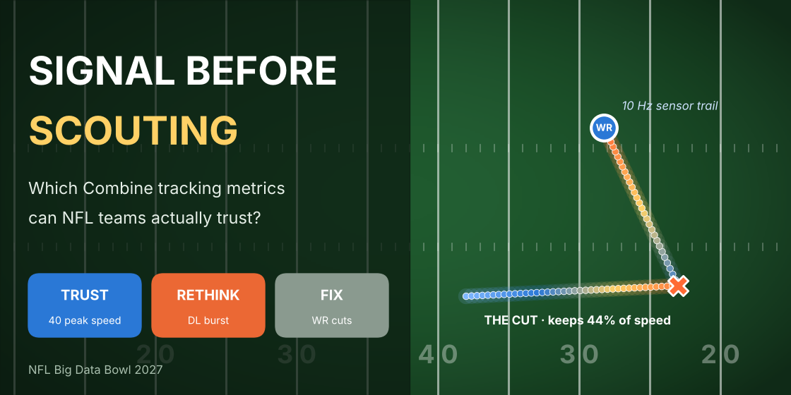

# Signal Before Scouting 🏈

**NFL Big Data Bowl 2027 (Kaggle) — University Track submission**

*Which NFL Combine tracking metrics can teams actually trust?*

## The question

At the NFL Scouting Combine, every rep is now recorded by sensors 10 times a second. Before a tracking number can predict NFL performance, it has to pass a simpler test: **if the same player does the drill twice, do we get the same number?**

This project builds a **reliability-first framework** and tests three Combine-to-NFL links using 2023–2025 Combine tracking and regular-season game tracking data.

## Key findings

| Link | Reliable? | Translates to NFL games? | Advice for teams |
|---|---|---|---|
| 40-yard **peak speed** → NFL in-game top speed | ✅ 0.99 | ✅ r = 0.47 | **Trust it.** It matches or beats the official 40 time |
| Pass-rush drill **burst** → NFL get-off | ⚠️ moderate | ❌ r = 0.03 | **Rethink the drill.** Add a snap cue |
| Route-drill **cut efficiency** → NFL separation | ❌ ≈ 0 | can't tell | **Fix the measurement.** More reps per route |

- NFL outcomes are stable player traits: game top speed (0.97), get-off (0.95) and separation (0.84).
- Tracking peak speed matches or beats the 40 time in 4 of 5 positions, and adds the most for offensive linemen (p = 0.011).
- Most single-rep drill metrics are too noisy to rank players. The writeup includes a "reps needed" table.

## Links

- 📓 **Kaggle notebook (all code):** https://www.kaggle.com/code/pratheekshs/signal-before-scouting-bdb-2027
- 📝 **Full writeup:** [`writeup.md`](writeup.md)

## Repository contents

| File | What it is |
|---|---|
| `signal_before_scouting.ipynb` | Full analysis notebook (runs on Kaggle with the competition data) |
| `writeup.md` | Competition writeup (about 1,600 words) |
| `figures/` | The 5 figures and the thumbnail |

## How to reproduce

The competition data cannot be shared here. To run the analysis:
1. Join the [NFL Big Data Bowl 2027](https://www.kaggle.com/competitions/nfl-big-data-bowl-2027) competition on Kaggle.
2. Open the Kaggle notebook linked above, or import `signal_before_scouting.ipynb` into a new Kaggle notebook with the competition data attached.
3. Click **Run All** (about 15 minutes).

**Tools:** Python, pandas, NumPy, SciPy, statsmodels, matplotlib

## Author

**Pratheeksh** — Electronics & Communication Engineering student, Atria Institute of Technology, Bengaluru · B.S. Data Science & AI, BITS Pilani
   
   ⭐ Submitted to the NFL Big Data Bowl 2027 (University Track), October 2026.
