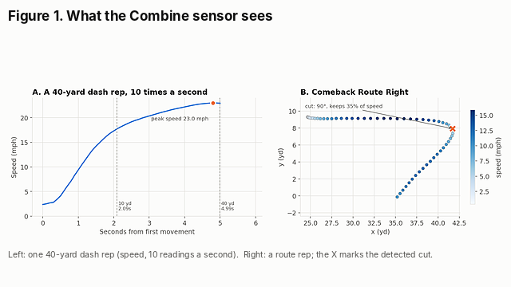
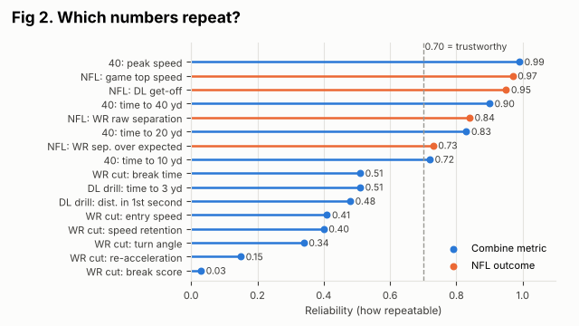
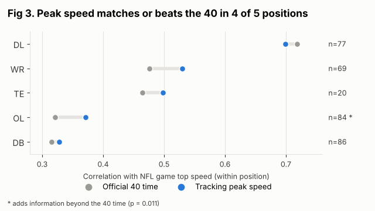
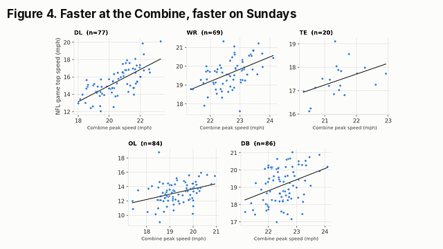
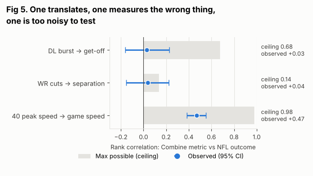

# Signal Before Scouting: Which Combine Tracking Metrics Can Teams Actually Trust?

*NFL Big Data Bowl 2027 · Full code: [Signal Before Scouting — public Kaggle notebook](https://www.kaggle.com/code/pratheekshs/signal-before-scouting-bdb-2027)*

## 1. Motivation

Every Combine rep now produces ten readings a second of position, speed and acceleration. That is a scouting gift and a trap: a metric that looks precise can still be noise. Before a tracking number can tell us anything about NFL performance, it has to pass a simpler test: **if the same player does the drill twice, do we get the same number?**

This submission builds a **reliability-first framework** and applies it to three Combine-to-NFL links:

| Link | Combine tracking metric | NFL regular-season outcome (tracking-derived) |
|---|---|---|
| Speed | 40-yard dash **peak speed** | **In-game top speed** (2023–2025 game tracking) |
| Pass rush | **First-step burst** in the pass-rush drill | **Get-off** on pass-rush snaps |
| Route running | **Cut efficiency** in route drills | **Separation over expected** on targets |

The answer is not "tracking works" or "tracking doesn't". Each link lands in a different place, and each tells evaluators to do something different:

* **Trust it:** tracking peak speed is near-perfectly repeatable and matches or beats the 40 time as a predictor of NFL game speed.
* **Rethink the drill:** pass-rush burst is repeatable enough to show a link, yet shows none. The drill measures a different skill from NFL get-off.
* **Fix the measurement:** route-cut metrics are too noisy from one rep to show anything. They need more reps per route.

## 2. Data and definitions

We use Combine tracking for 510 prospects (2023–2025 classes), official Combine results, `player_play.csv` and 2023–2025 regular-season game tracking. All comparisons are made **within position** (or within role for defensive line: edge vs interior), because a 320-lb guard and a 190-lb corner are not on the same scale.

**Combine metrics (per rep, from 10 Hz tracking)**
* *40-yard dash:* peak speed, and time from first movement (speed > 0.5 yd/s) to 10, 20 and 40 yards. Tracking 40 times agree with the official stopwatch (r = 0.88).
* *Pass-rush drill (DL):* distance covered in the first second after movement starts, and time to 3 yards.
* *Breaking-route drills (WR):* we locate the cut as the largest change of running direction over ±0.3 s while the receiver is running both before and after it, which ignores the slow-down after the catch. At the cut we measure entry speed, turn angle, **speed retention** (lowest speed ÷ entry speed), **re-acceleration** and **break time** (seconds below 70 % of entry speed). Drill names and menus change between Combine years (e.g. `SPEED_OUT_LEFT` vs `SPEED_OUT_ROUTE_LEFT`), so every cut metric is standardized within drill and year.

**NFL outcomes**
* *Game top speed:* each player's maximum speed on every play; his value is the mean of his 10 fastest plays (minimum 100 plays; readings above 25 mph dropped as glitches).
* *Get-off:* `player_get_off` on pass-rush snaps, after removing impossible values (< 0.3 s) and the 2.0 s cap; player median, minimum 50 snaps.
* *Separation over expected (SOE):* separation at the throw minus the separation expected for that route type, coverage (man/zone) and pass depth (regression on 38,030 targets). Go and fade routes have no cut, so they serve as a placebo.

**Reliability.** For Combine metrics: rank correlation between a player's first and second rep of the same drill, scaled to the number of reps actually averaged (Spearman–Brown). For NFL outcomes: split-half rank correlation (plays or games randomly split in two), scaled the same way. **0.70** is used as a working threshold for decisions about an individual player.

**The ceiling.** Two measurements can never correlate more strongly than **√(reliability₁ × reliability₂)**. Comparing each observed link to its ceiling separates "the trait doesn't matter" from "we can't measure it well enough to tell".

## 3. Result 1: NFL outcomes are stable; Combine metrics vary widely

All four NFL outcomes are stable player traits: game top speed (0.97), get-off (0.95), raw separation (0.84) and separation over expected (0.73). Any failure to predict them is not because the NFL side is random.

The Combine side splits sharply:

* **The 40-yard dash is the gold standard.** Peak speed is almost perfectly repeatable (single-rep r = 0.98). Each later split is more reliable than the one before it: the 10-yard time from tracking is the weakest (single rep 0.56), largely because a sensor cannot see the exact start the stopwatch uses (tracking vs official 10-yard split: r = 0.40).
* **Drill-specific metrics are much noisier.** Pass-rush burst repeats at 0.32–0.34 per rep. Route-cut metrics range from 0.51 (break time) down to 0.15 (re-acceleration).
* **A "general agility" composite does not exist in this data.** A player's cut-efficiency score averaged across different routes has reliability 0.03: how a receiver cuts on a curl says almost nothing about how he cuts on a slant.

**Table 1. Reps needed before a tracking metric reaches reliability 0.70**

| Metric | Single-rep r | Reps needed |
|---|---|---|
| 40: peak speed | 0.98 | **1** |
| 40: time to 40 / 20 yd | 0.82 / 0.71 | **1** |
| 40: time to 10 yd | 0.56 | 2 |
| WR cut: break time | 0.51 | 3 |
| WR cut: entry speed / speed retention | 0.41 / 0.40 | 4 |
| DL drill: time to 3 yd / distance in 1st second | 0.34 / 0.32 | 5–6 |
| WR cut: turn angle | 0.34 | 5 |
| WR cut: re-acceleration | 0.15 | 13 |

Most players run each route drill **once**. Under that protocol, every route-cut metric in Table 1 is below the threshold.

## 4. Result 2: peak speed translates, and beats the stopwatch where it matters

If reliability is the bottleneck, the most reliable metric should be the one that translates. It is.

Within position, Combine peak speed correlates **0.47** with NFL game top speed (95 % CI 0.38–0.55, n = 336). When the official 40 time and tracking peak speed enter the same model (with position and weight), **peak speed remains significant (p = 0.003) and the 40 time does not (p = 0.36)**. Whatever the 40 tells a team about game speed, peak speed already captures.

The gain in total accuracy is modest. Ten-fold cross-validated R² is 0.850 for the stopwatch model and 0.854 for the tracking model, because position explains most of the spread in game speed. The value is in **within-position ranking**:

Peak speed matches or beats the 40 time in four of five position groups. The clearest case is the **offensive line**. There, peak speed adds information beyond the 40 (≈ +1 mph of game speed per standard deviation, p = 0.011), probably because linemen's 40 times are dominated by a slow start that has little to do with how fast they move on pulls and screens. Receivers show the same direction (p = 0.09). Defensive linemen are the exception: there the 40 time is marginally better (0.72 vs 0.70). With five groups tested, the OL result should be read as strong evidence, not proof.

## 5. Result 3: two links that fail, for different reasons

**Pass-rush burst → get-off: the drill measures the wrong thing.** Averaged over two reps, the burst metric has reliability 0.48, and get-off is 0.95, so a correlation as large as 0.68 was measurable. The observed within-role correlation is **0.03** (95 % CI −0.16 to 0.23, n = 103), and it is near zero for edge rushers and interior linemen separately. This is a real null, not a measurement failure. NFL get-off is largely **reaction**: how fast a rusher moves once the ball is snapped. The pass-rush drill starts on the player's own movement, so it captures acceleration after the decision, not the decision itself.

**Route cuts → separation: too noisy to test.** The cut-efficiency score has a ceiling of only **0.14**. The observed correlation (0.04 on breaking routes; −0.10 on the go-route placebo) sits inside that ceiling. The data cannot tell us whether cut mechanics matter. They can tell us that a single rep per route is not enough to find out.

## 6. What teams can do with this

1. **Use tracking peak speed as the speed number of record**, alongside the 40, and especially for offensive linemen, where it adds information the stopwatch misses. One rep is enough.
2. **Treat single-rep start and cut metrics as notes, not measurements.** Table 1 gives the rep counts needed before a number should drive a ranking. At pro days and private workouts, teams control the protocol: three to five reps of the same route make cut metrics usable.
3. **Redesign the pass-rush drill to include a snap cue** (ball or light), so tracking can measure reaction, the part of get-off that matters on Sundays.
4. **Run the reliability-and-ceiling check on any new tracking metric before it reaches a draft board.** It needs only two reps of a drill and a random split of NFL plays, takes minutes, and works week to week on in-season tracking metrics too. It answers the first question a front office should ask of any number: *is this real?*

## 7. Limitations

* Samples are modest (20–86 players per position in the speed analysis; about 100 per link in the DL and WR analyses). Position-level p-values are not corrected for multiple comparisons.
* Route-drill reliability rests on 63–64 repeated rep pairs, because most players run each route once.
* Movement onset is inferred from speed; early-phase times inherit that uncertainty.
* NFL outcomes depend on role, scheme and opportunity. We adjust for position, route type, coverage and depth, but not for team or quarterback, and only players with enough snaps enter each test.

## Appendix

*Why a naive "all drills" model misleads.* An initial approach that averaged tracking features across all drills and predicted career games appeared to beat Combine results. The leading features were counts (drills run, attempts, rep duration), which differ by draft year because drill names and menus changed each year. Draft year, in turn, drives career totals. This confound motivated the per-drill, within-position, reliability-first design used here.

*Code.* All figures, tables and numbers are reproduced by the [public Kaggle notebook](https://www.kaggle.com/code/pratheekshs/signal-before-scouting-bdb-2027) (Run All, about 15 minutes).
